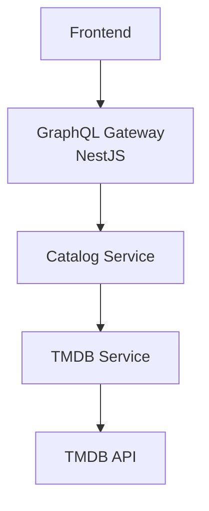
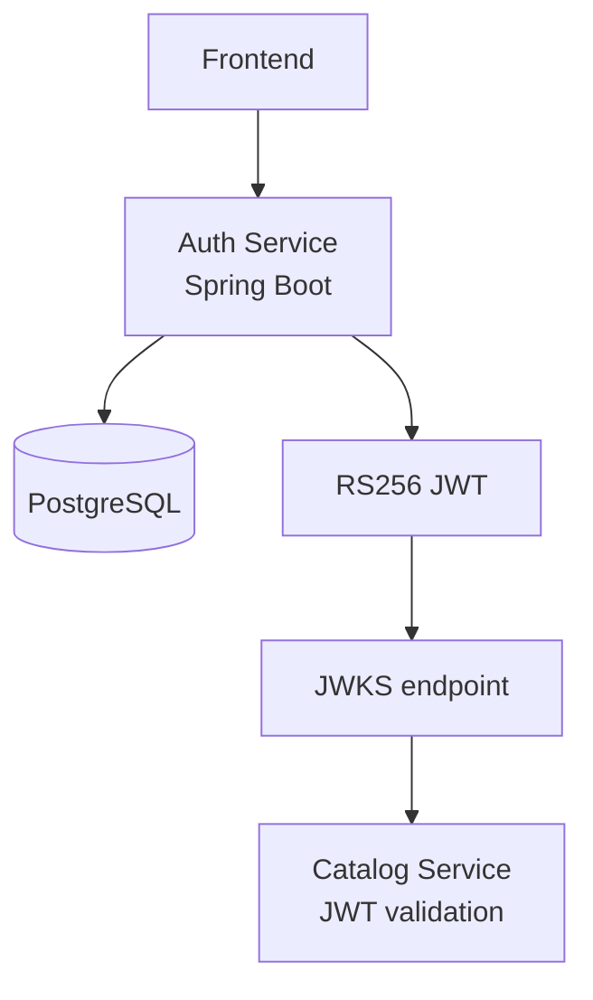

# ScoreFilm

ScoreFilm is an open-source backend for rating movies, TV shows, anime, and
documentaries through multiple dimensions rather than a single score. It uses
[TMDB](https://www.themoviedb.org/) for media metadata and is built as a
learning project for modern microservice architecture.

## Architecture

The catalog service exposes a GraphQL API and delegates media discovery to
TMDB. The authentication service owns identities and issues RS256 JWTs.





The catalog service validates access tokens against the authentication
service's JWKS endpoint, allowing signing keys to remain private while public
keys are distributed safely.

## Tech Stack

| Area | Technologies |
| --- | --- |
| Authentication | Spring Boot, Spring Security, PostgreSQL, JWT RS256, JWKS |
| Catalog API | NestJS, GraphQL, Apollo, MongoDB |
| Media metadata | TMDB API |
| Local infrastructure | Docker, Docker Compose |

## Features

### Available

- Authentication and authorization
- Reviews with multidimensional ratings
- Favorites and watchlists
- TMDB integration for media metadata
- GraphQL API backed by MongoDB
- PostgreSQL-backed authentication data
- RS256 JWT issuance and JWKS-based verification

### Planned

- Redis cache
- Observability
- CI/CD pipelines
- AWS deployment
- Angular frontend

## Project Structure

```text
ScoreFilm/
├── .agents/            # Local agent workflow configuration
├── .vscode/            # Shared editor settings
├── auth-service/       # Spring Boot authentication and JWKS service
├── catalog-service/    # NestJS GraphQL catalog, reviews, and TMDB integration
├── docs/               # Project documentation
└── infrastructure/     # Docker Compose and future infrastructure definitions
```

## Getting Started

### Prerequisites

- Java 25
- Node.js and npm
- Docker and Docker Compose
- PostgreSQL
- MongoDB
- A TMDB API key or read access token
- OpenSSL for generating local RSA keys

### 1. Clone the repository

```bash
git clone <repository-url>
cd ScoreFilm
```

### 2. Configure local environment variables

Local `.env` files and RSA private keys are intentionally excluded from GitHub.
Use the checked-in examples as the source of truth and keep the populated files
untracked.

```bash
cp catalog-service/.env.example catalog-service/.env
```

Configure the TMDB placeholder in `catalog-service/.env`, then set the database
and JWT settings described in
[`application.example.yml`](auth-service/src/main/resources/application.example.yml).

### 3. Generate RSA keys

Generate the keys expected by the authentication service in
`auth-service/src/main/resources/certs/`. The exact commands and expected
filenames are documented in
[`certs/README.md`](auth-service/src/main/resources/certs/README.md).

### 4. Start local infrastructure

```bash
docker compose -f infrastructure/docker/docker-compose.yml up -d
```

This starts PostgreSQL, MongoDB, and Redis for local development.

### 5. Run the authentication service

Configure its environment variables or local Spring configuration first, then
run from the service directory:

```bash
cd auth-service
./gradlew bootRun
```

On Windows PowerShell, use `./gradlew.bat bootRun`.

### 6. Run the catalog service

In a second terminal:

```bash
cd catalog-service
npm install
npm run start:dev
```

The GraphQL API is available at `http://localhost:3001/graphql` by default.

## Environment Variables

| File | Purpose |
| --- | --- |
| [`catalog-service/.env.example`](catalog-service/.env.example) | Documents the NestJS port, MongoDB URI, JWKS endpoint, and TMDB settings. |
| [`auth-service/src/main/resources/application.example.yml`](auth-service/src/main/resources/application.example.yml) | Documents Spring Boot database and JWT configuration without credentials. |
| [`auth-service/src/main/resources/certs/README.md`](auth-service/src/main/resources/certs/README.md) | Explains secure RSA key generation and placement. |

Never commit populated `.env` files, database credentials, TMDB tokens, or RSA
private keys. Use environment variables or a secrets manager in deployed
environments.

## Roadmap

- [x] Spring Boot authentication service
- [x] NestJS GraphQL catalog service
- [x] PostgreSQL and MongoDB persistence
- [x] JWT RS256 issuance and JWKS validation
- [x] Reviews, favorites, and watchlists
- [x] TMDB metadata integration
- [x] Docker Compose local dependencies
- [ ] Redis cache
- [ ] Application metrics, logs, and tracing
- [ ] CI/CD pipeline
- [ ] AWS deployment
- [ ] Angular frontend

## License

ScoreFilm is licensed under the MIT License.
